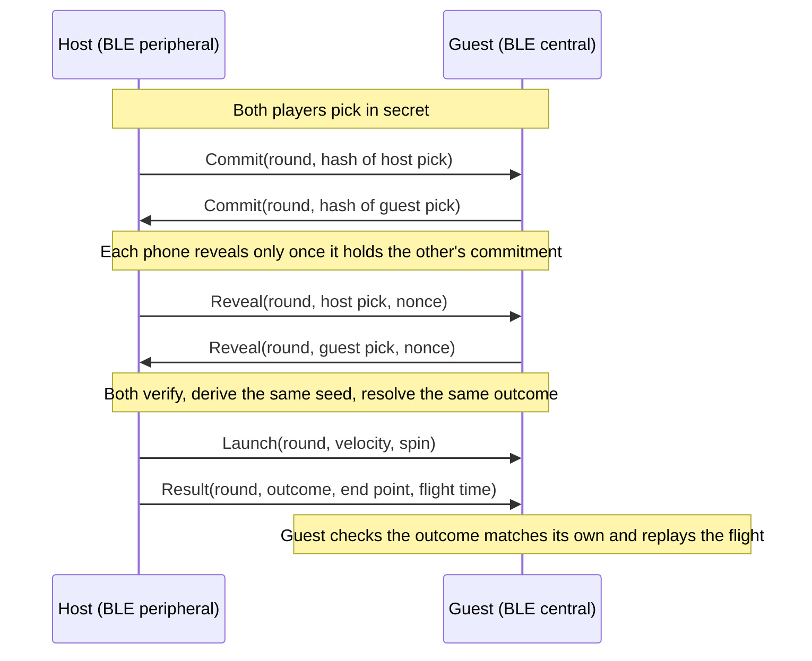

# Duel protocol and Bluetooth spike guide

This is the wire protocol two phones speak in a Stare-Down Shootout, and what the weeks 1–2 Bluetooth spike has to prove. The code lives in `packages/com.freekickclassics.duellink` (game-agnostic) and `packages/com.freekickclassics.core` (`ShootoutSession`).

## Design rules

- **Every message fits in one 20-byte BLE write.** 20 bytes is the payload of the default ATT MTU of 23, so the game never needs to negotiate a bigger MTU. The largest message is 18 bytes. The tests check this.
- **The link is ordered and reliable while connected, and drops messages when it isn't.** `IDuelLink` promises nothing more, so BLE, same-Wi-Fi UDP and online play can all sit behind it.
- **Reconnects are just replays.** Each phone keeps everything it sent in the current and previous round and resends it all when the link comes back. Receivers ignore exact duplicates and anything from a round they've finished. There are no extra resync messages.
- **Neither phone has to trust the other.** Picks are hidden with commit-reveal, the dice are rolled from both phones' secrets, and the guest checks every result the host sends.

## One kick

The two commits can happen in either order, and so can the two reveals. Before the first kick, each phone sends `Hello`, and the host then sends `MatchSetup`.

## Messages

All multi-byte numbers are little-endian. `round` is the kick number modulo 256.

| Type | Byte | Dir | Size | Layout after the type byte |
| --- | --- | --- | --- | --- |
| Hello | `0x01` | both | 12 | protocol version, game id (`0x01` = Free Kick Classics), role (0 host, 1 guest), 8-byte nonce |
| Commit | `0x02` | both | 18 | round, 16-byte commitment |
| Reveal | `0x03` | both | 18 | round, 4-byte pick, 12-byte nonce |
| Ping / Pong | `0x04` / `0x05` | both | 3 | u16 sequence |
| Abort | `0x06` | both | 2 | reason code (`AbortReason`) |
| MatchSetup | `0x40` | H→G | 12 | era, wind x and z (s8, 0.1 m/s), rain (0–255), altitude (u16 m), kicks per side, u32 rules fingerprint |
| Launch | `0x41` | H→G | 14 | round, velocity x/y/z (s16, 0.01 m/s), spin x/y/z (s16, 0.01 rad/s) |
| Result | `0x42` | H→G | 11 | round, outcome, end point x/y/z (s16 mm), flight time (u16 ms) |

Types `0x01`–`0x3F` belong to the link layer and `0x40` up to the game, so Dunk Duel and Volley Duel can reuse the link layer with their own game messages.

**Picks (4 bytes).** Kicker: zone 0–8 (row × 3 + column, from the bottom-left in the kicker's view), strike type, power 0–255, flags (bit 0 stutter). Keeper: dive side, timing (early, late, stay big), 0, flags (bit 0 shuffle). Unknown values or bits are rejected.

## Commit-reveal

`commitment = SHA-256("DLC1" ‖ session id ‖ round ‖ committer role ‖ pick ‖ nonce)`, truncated to 16 bytes.

- The **nonce** is 96 random bits. The pick space is tiny (a few thousand kicks), so without a nonce the other phone could simply hash every possible pick.
- The **session id** is a SHA-256 of a tag and both Hello nonces (host first), truncated to 8 bytes. It stops a commitment from one match being replayed in another. The exact byte layouts are in `Commitment.cs` and `SharedRandomness.cs`.
- The **committer role** stops mirroring. Without it, a guest could echo the host's commitment, wait for the host's reveal, and echo that back too, so the keeper would always "pick" the kicker's corner. `AGuestCantMirrorTheHostsPick` tests exactly this attack.
- SHA-256 is implemented in plain C# (`Sha256.cs`), so it hashes the same way on every phone and doesn't rely on `SHA256.Create()`, which IL2CPP stripping can break. It is tested against published vectors and against .NET's implementation.

A phone that reveals before holding the other's commitment is breaking protocol, and the session aborts.

## Fair dice and who checks whom

- **Who kicks first** is a coin toss from the session id, so neither phone chooses it.
- **Each kick's seed** is a SHA-256 of a tag, the session id, the round and both phones' reveal nonces. Both nonces are committed before either is revealed, so neither phone can grind the seed. The seed drives the accuracy roll, the save roll, where in the zone the ball goes, and the knuckle wobble.
- **The outcome comes from whole-number rules** (`PenaltyResolver`), so both phones compute it exactly. The host sends it anyway, along with the launch values, so the guest can replay the same flight. The guest aborts with `OutcomeMismatch` if the outcome differs from its own, or if the end point is more than 10 cm from the agreed target.
- **The flight is host-authoritative.** Floating-point physics can differ in the last bits between chips (IL2CPP's C++ compiler may fuse multiply-adds), so the guest simulates the launch it was sent, then uses `TrajectoryReconciler` to steer smoothly onto the host's end point.
- **What this doesn't stop:** a player who quits after seeing a reveal they don't like. Treat a mid-kick disconnect that never comes back as a forfeit in the game layer.

## Reconnects

On every transition to `Connected`, a session resends its `Hello`, the host's `MatchSetup`, and every message it sent in the previous and current rounds, in the original order. One round of history is enough: the host only finishes a round after the guest has revealed in it, so the two phones are never more than one round apart.

Receivers place each message's round relative to their own: an older round is ignored, a newer round is a protocol violation, and the current round is processed unless it's an exact duplicate. A `Hello` with a *different* nonce means the other app restarted and lost the match, so the session aborts. `SurvivesDroppedConnectionsAtAnyMoment` plays full matches while dropping the link at random (in-flight messages are lost), and both phones must finish with identical results.

## Bluetooth LE layout

The host is the **peripheral** and the guest is the **central**.

| Item | Value |
| --- | --- |
| Advertised service UUID | `c6eb9b26-a6da-4739-889b-6fa4GGVVRRRR`: `GG` game id, `VV` protocol version, `RRRR` room code 0000–9999 in hex (`RoomAdvertisement`) |
| Guest → host characteristic | `fb4c6981-1f5e-4f3a-9b3c-21272af45b9b`, write with response |
| Host → guest characteristic | `a3cc2bbd-983a-428e-8a6e-2bebbb302a90`, notify |

**Why the room code is inside the UUID:** service UUIDs are the only advertising field both platforms let an app set as a peripheral. iOS advertises only a local name and service UUIDs, and Android can only include the phone's own Bluetooth name, not a custom one. One 128-bit UUID (18 bytes) plus flags (3 bytes) also fits in the 31-byte legacy advertising packet. An Android guest can scan with a UUID mask on the fixed first 96 bits and list nearby rooms. An iOS guest builds the exact UUID from the typed-in code and scans for it.

## What the native layer must handle

These are the usual traps. Verify each one on the phones during the spike.

- **Not every Android can be a peripheral.** Check `BluetoothAdapter.isMultipleAdvertisementSupported()` and that `getBluetoothLeAdvertiser()` isn't null. If a phone can't host, the UI should make the other phone host instead of failing.
- **One GATT operation at a time on Android.** Queue writes, and wait for `onCharacteristicWrite` (central) or `onNotificationSent` (peripheral) before sending the next one.
- **iOS notification back-pressure.** When `updateValue(_:for:onSubscribedCentrals:)` returns false, wait for `peripheralManagerIsReady(toUpdateSubscribers:)` and resend.
- **Android GATT status 133.** It's common on cheap phones: `close()` the `BluetoothGatt`, wait briefly, and reconnect, with a retry limit.
- **Connection interval.** An Android central can call `requestConnectionPriority(CONNECTION_PRIORITY_HIGH)` for lower latency. Measure the round-trip time with and without it.
- **Threads.** Raise `IDuelLink` events on Unity's main thread: queue native callbacks and pump them from `Update`.
- **Permissions.** On Android 12+, request `BLUETOOTH_SCAN` (with `neverForLocation`), `BLUETOOTH_CONNECT` and `BLUETOOTH_ADVERTISE`; the user sees one "Nearby devices" prompt. On Android 11 and below, request `ACCESS_FINE_LOCATION`. On iOS, set `NSBluetoothAlwaysUsageDescription`. Explain why before the system prompt appears.
- **Foreground only.** iOS stops advertising the local name and moves service UUIDs to an overflow area in the background. A face-to-face game can ask both players to keep the app open.

## Spike plan (weeks 1–2)

Goal: a yes/no answer on raw BLE GATT between Android and iOS before building anything else.

1. **Adapter.** Implement `IDuelLink` on top of the Asset Store plugin. If it falls short, write a thin Swift CoreBluetooth and Kotlin plugin that only moves byte arrays. Discovery (advertise, scan, connect) sits outside `IDuelLink`, behind whatever factory the adapter needs.
2. **Spike scene.** Connect two phones with a room code, attach an `RttProbe` on both, send 200 pings at 5 Hz, then play scripted shootouts with `ShootoutSession` (the same code the tests run, with random picks).
3. **Device matrix.** Test iPhone ↔ cheap Android, iPhone ↔ Samsung, iPhone ↔ Xiaomi and Android ↔ Android, **with each phone as host**.
4. **Measure and record** for each pair:
   - time from tapping Join to connected
   - RTT median and p95 (`RttStats.ToString()`), with and without high connection priority on Android
   - lost pings
   - time to reconnect after walking out of range or toggling Bluetooth, and whether the shootout carries on
   - desyncs (`OutcomeMismatch`) over 100 kicks; this must be zero
   - whether `RandomNumberGenerator` and the rest of the core survive an IL2CPP release build with managed stripping set to High
5. **Suggested pass bar.** Every pair connects with either phone as host, or the app can tell which phone must host. Median RTT is under 100 ms and p95 under 250 ms (the 1.5-second run-up hides more than that). Reconnects complete within 5 seconds. There are no desyncs.

If the bar isn't met, the fallback order in the concept still applies: same-Wi-Fi UDP behind the same `IDuelLink`, then online play.
